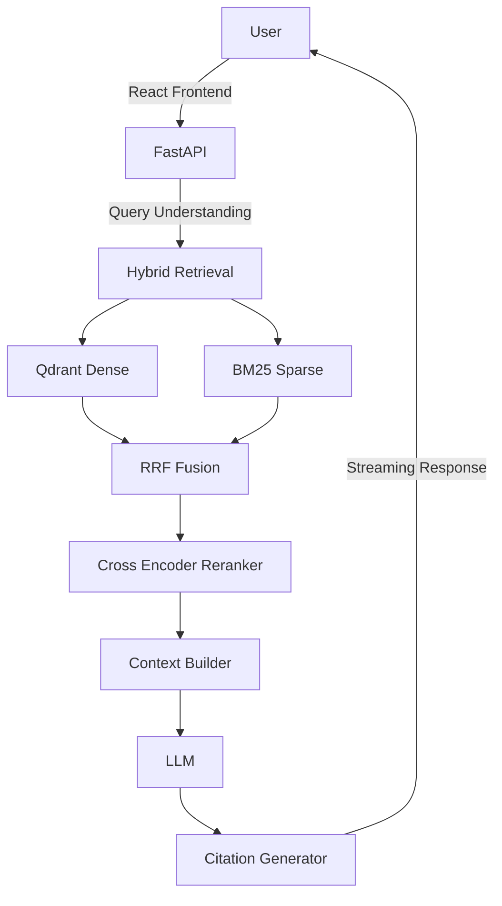

# CareerMind AI — Intelligent Career & Interview Copilot

An AI career assistant with an advanced RAG pipeline to help users with job matching, resume analysis, skill-gap analysis, and interactive mock interviews.

## Project Structure

```
careermind-ai/
├── frontend/             # React/Vite/TypeScript frontend
├── backend/              # FastAPI Python backend
├── docker-compose.yml    # Docker setup (PostgreSQL, Qdrant, etc.)
└── .env.example          # Example environment variables
```

## Architecture



## Quick Start (Docker)

1. Copy `.env.example` to `.env` and fill in the values.
2. Run `docker compose up -d` to start the backend, database, and vector store.

## Development

See the `docs/` folder for detailed deployment and setup instructions.
